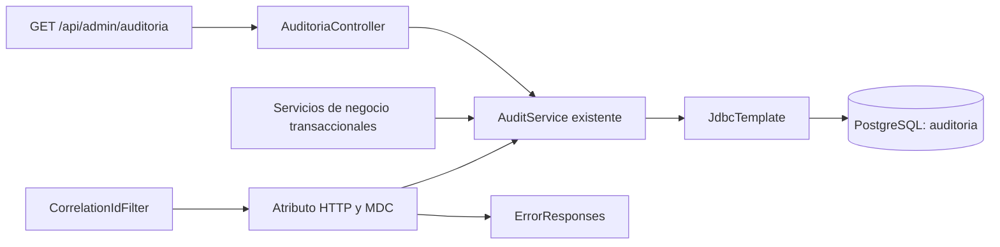

# Auditoría e infraestructura - MediLink MVP v1.4.3

## Alcance y diagnóstico

Revisión del 26/10/2026 sobre `auditoria-infraestructura`, inicialmente en
`ca7d63e`. Se consultó el remoto y se actualizó su información con `git fetch`:
la rama coincidía con `origin/auditoria-infraestructura` y `origin/main`, y
contenía todos los commits de `origin/develop` (14 commits propios, 0 faltantes).
El árbol estaba limpio. No se hicieron commits, pushes, merges ni PR.

Autoridad funcional: PDF entregado “Medlink documento central acotado”,
v1.4.3 del 27/09/2026, especialmente 5.2.1, RN-43/44/47/50, CV-02/03,
11.1/11.2/11.3/11.8, RNF-05/10/12/13 y AC-53/56/59. El UML se utilizó como
referencia estructural y se encontraron componentes antiguos sin implementación.

Ya existían y se reutilizan: `AuditService` JDBC, tabla y enums de Auditoría,
índices por usuario/actor/entidad, triggers de protección UPDATE/DELETE,
transacciones JPA/JDBC compartidas, JWT y roles, `CorrelationIdFilter`,
`GlobalExceptionHandler`, `ErrorResponses`, `ApiException`, `ApiClock`,
`PageDTO` y `PageRequests`. Los servicios de Administración, Auth, Farmacia,
Stock, Medicamentos, Presentaciones y cierre de Reservas ya registraban los
eventos implementados. Faltaban la consulta administrativa, sus DTO/filtros,
pruebas propias y evidencia reproducible de restauración.

## Responsabilidades y arquitectura



`AuditoriaController` aplica seguridad de método y valida parámetros HTTP;
`AuditoriaFiltro` valida identificadores, dominios y rangos; `AuditService`
construye consultas parametrizadas y mapea DTO. No hay entidad JPA ni repository
nuevo. Se conserva el constructor y la firma de `record` para los módulos actuales.

La lectura usa `REPEATABLE_READ` para que total y página correspondan al mismo
snapshot dentro de una solicitud. Distintas páginas solicitadas por HTTP pueden
reflejar nuevas inserciones; el orden incluye id para resolver empates.
`actorNombre` se obtiene del perfil actual de la Cuenta (nombre y apellido),
sin consultar hash, JWT ni sesiones. No es un snapshot histórico del nombre.
El actor automático no tiene Cuenta ni nombre y usa `rol=SISTEMA`.

## Endpoint administrativo

`GET /api/admin/auditoria` -> `PageDTO<AuditoriaDTO>`, solo `ADMINISTRADOR`.
Un Usuario u Operador autenticado recibe 403 `FORBIDDEN`; sin JWT válido,
401 `INVALID_TOKEN`. La consulta del servicio vuelve a comprobar el rol.

| Parámetro | Semántica |
| --- | --- |
| usuarioId | Identificador positivo de Usuario sujeto; filtra `usuario_relacionado_id` |
| actorCuentaId | Identificador positivo de Cuenta que actuó |
| rol | USUARIO, OPERADOR, ADMINISTRADOR o SISTEMA |
| accion | Dominio normativo de 5.2.1, igual al enum SQL existente |
| tipoEntidad | CUENTA, FARMACIA, MEDICAMENTO, PRESENTACION, STOCK, RESERVA, PRESCRIPCION, OPERADOR, SUSPENSION |
| entidadId | Identificador positivo de la entidad afectada |
| desde / hasta | Instantes ISO-8601 con offset; precisión de milisegundos; intervalo `[desde,hasta)` |
| page / size | Defaults 0/20; page >= 0; size 1..100; protección de overflow existente |
| sort | Repetible: `fechaHora,asc\|desc` y `id,asc\|desc` |

Todos los filtros son opcionales y se combinan con AND. Desde y hasta pueden
usarse individualmente. Con ambos, `desde >= hasta` es 400 `VALIDATION_ERROR`.
Los ids inexistentes devuelven una página vacía. Un filtro vacío, dominio ajeno,
fecha inválida, id no positivo, parámetro escalar repetido o sort inválido
devuelve 400. Se exige offset; no se interpreta una fecha local sin zona.

Default: `fechaHora DESC,id DESC`. Los órdenes explícitos reutilizan
`PageRequests`; si no incluyen id se agrega `id ASC`, según la convención común.
No se aceptan otros campos de orden ni SQL desde parámetros.

Ejemplo (el cliente debe codificar el signo `+` de los offsets positivos):

```text
GET /api/admin/auditoria?usuarioId=4&rol=SISTEMA&tipoEntidad=SUSPENSION&desde=2026-10-01T00:00:00.000-03:00&page=0&size=20&sort=fechaHora,desc&sort=id,desc
Authorization: Bearer <JWT administrador>
X-Correlation-Id: 2b6e3cde-6d44-4d5c-8ef4-9ba706e5dd93
```

El DTO contiene `id`, `fechaHora`, `actorCuentaId?`, `actorNombre?`, `rol`,
`accion`, `tipoEntidad`, `entidadId`, `usuarioRelacionadoId?`, `motivo?`,
`correlationId?`, `resumenAnterior?`, `resumenPosterior?`. `rol` es el nombre
REST normativo de la columna `actor_rol`. Fechas de salida: Argentina, offset
y tres decimales, mediante `ApiClock`. Los opcionales ausentes conservan la
política JSON existente. El envelope conserva `content,page,size,totalElements,
totalPages,first,last`.

## Registro, privacidad e inmutabilidad

`record` exige una transacción de negocio existente (`Propagation.MANDATORY`).
No abre una transacción independiente; un rollback elimina tanto la mutación
como su auditoría, y un fallo del INSERT impide confirmar el negocio.
Las creaciones requieren resumen posterior; las modificaciones de los servicios
existentes conservan sus resúmenes anterior y posterior. Los triggers originales
siguen bloqueando UPDATE y DELETE y no existe endpoint de modificación/borrado.

Se implementó una lista explícita de campos escalares de resúmenes, aplicada al
INSERT y a la lectura de registros anteriores. Se omiten claves no autorizadas,
objetos anidados y campos como password/passwordHash/contrasena/JWT/jti/token/
privateKey. Se preservan los campos operativos de todos los productores actuales,
incluyendo nombres físicos históricos del seed (`id_farmacia`,
`cantidad_disponible`, `causa`). `tokenVersion` es un contador de invalidación,
no un token, y conserva la evidencia existente del cambio de Cuenta/contraseña.

Esta protección no clasifica semánticamente texto libre: los productores siguen
siendo responsables de no colocar credenciales en `motivo` ni en un campo
operativo permitido. Antes de incorporar un nuevo resumen, revisar su necesidad
funcional y la lista de campos. Las credenciales no forman parte del DTO y no
se serializan objetos Cuenta. Los registros antiguos se proyectan sin secretos;
no se reescriben filas protegidas para sanearlas.

`usuarioRelacionadoId` ya lo informan los cambios de Cuenta de Usuario,
cambios de contraseña de Usuario y las Suspensiones creadas internamente.
Las acciones de Farmacia, catálogo y Stock no adquieren artificialmente un
Usuario relacionado. RN-44 permite que el MovimientoStock automático sea la
trazabilidad del saldo sin una Auditoría redundante.

## Correlación y errores

El filtro acepta UUID canónicos, conserva los válidos y reemplaza valores
ausentes, inválidos o abreviados como `1-1-1-1-1`. Comparte el id entre atributo
HTTP, header de respuesta, MDC, errores y auditoría; limpia MDC aun cuando falla
el procesamiento. Se agregó el campo de correlación al patrón de logs.
Se reutilizan sin alterar códigos los handlers REST y de seguridad existentes.
`detalle` puede ser null u omitido conforme 11.2; `timestamp` y `correlationId`
son obligatorios. Los fallos internos siguen sin exponer SQL o excepciones.

## PostgreSQL, Flyway y Docker

V1 y V2 permanecen intactas. V3 agrega únicamente
`ix_auditoria_fecha(fecha_hora DESC,id_auditoria DESC)` para la consulta global.
La tabla conserva sus nombres, FKs, enums, JSONB y UUID físicos.

Dos rutas compatibles, documentadas en `database/README.md`:

1. Base vacía gestionada por Flyway: migrar V1, V2 y V3; baseline desactivado.
2. Volumen creado por Compose con scripts 01/02: verificar procedencia v1.4.3,
   adoptar explícitamente baseline 1 una sola vez y aplicar V2/V3.

Una base no vacía desconocida continúa fallando sin baseline explícito. No se
eliminan datos ni se activa baseline por defecto. Compose mantiene `pgdata`,
puertos de PostgreSQL/Adminer solo en localhost y secretos locales en `.env`.
La clave JWT sigue siendo obligatoria y externa. No se modificó Compose porque
su configuración ya cumple estas necesidades. Las pruebas usan bases nuevas,+nunca `medlink` de desarrollo.

El verificador del seed comparaba fechas JSON por representación textual;
fallaba si su sesión usaba UTC y el seed se había creado en Argentina. Se
corrigió para comparar instantes `timestamptz` sin truncar precisión; ni seed
ni esquema aplicado fueron modificados.

## Backup y restauración - RNF-12 / AC-59

`scripts/backup_restore.ps1` requiere PowerShell 7+ y Docker. Rechaza sobrescribir
backup o evidencia existentes, usa `pg_dump -Fc` dentro del contenedor y copia el
binario con `docker cp`, evitando corrupción por redirección de PowerShell.
Crea una base de destino con UUID nuevo y restaura con `--exit-on-error` y
`--single-transaction`. No ejecuta `--clean` ni restaura sobre el origen.

Compara esquema, conteos y checksum de todas las filas de cada tabla pública.
La comparación de esquema conserva funciones/triggers/índices/defaults y usa
el deparser de PostgreSQL para normalizar paréntesis redundantes en CHECKs;
excluye solo los marcadores aleatorios de `pg_dump`. La comparación de filas
ordena JSON de cada fila: no depende del orden físico. La evidencia contiene
nombres de tablas, cantidades y hashes, no filas ni credenciales.

Prueba aislada reproducible desde la raíz, sin usar un servicio existente:

```powershell
pwsh -File ./scripts/backup_restore.ps1 -Fixture `
  -BackupPath ../medlink-fixture-20261026.dump `
  -EvidencePath ./evidencias/backup-local-20261026.md
```

Este modo crea un contenedor sin publicar puertos, carga esquema/seed, aplica
SQL de V2/V3 y verifica el seed. Prueba las 16 tablas de la instalación por
scripts antes de la adopción Flyway. El contenedor y su volumen descartable se
eliminan en finally; el backup queda conservado fuera del repositorio.

Backup de una base local indicada explícitamente, con restauración separada:

```powershell
pwsh -File ./scripts/backup_restore.ps1 `
  -SourceContainer medlink-db -Database medlink -User medlink `
  -BackupPath ../medlink-20261026.dump `
  -EvidencePath ./evidencias/backup-desarrollo-20261026.md
```

En ese modo se elimina únicamente la base de restauración generada por el
script y sus archivos temporales. El origen queda intacto. El usuario SQL
necesita lectura para pg_dump y permisos para crear/eliminar la base temporal.
Para comparar el backup con conteos/checksums del origen usar una ventana sin
escrituras concurrentes: pg_dump tiene snapshot propio y la verificación lee
por separado. La comparación completa está pensada para el volumen del MVP;
no se establece RPO/RTO ni SLA. Repetir antes de cada entrega evaluada y guardar
la evidencia. Mantener dumps fuera de Git y bajo los permisos locales adecuados.

Evidencia ejecutada: `evidencias/BACKUP_RESTORE_2026-10-26.md` (fixture) y
`evidencias/BACKUP_RESTORE_FLYWAY_2026-10-26.md` (base de tests con Flyway).
En Windows anteriores sin PowerShell 7 se mantienen los comandos manuales
con `docker cp` de `database/README.md`.

## Pruebas y CI

Desde `backend`: `.\mvnw.cmd clean verify`. Con Docker disponible las suites
levantan PostgreSQL 16 real por Testcontainers; también aceptan
`MEDLINK_TEST_DB_URL/USER/PASSWORD` para una base **dedicada y descartable**.
La prueba de adopción crea/elimina solo una base con nombre UUID propio;
necesita permiso CREATEDB, como los servicios de CI/Testcontainers existentes.

| Suite nueva o ampliada | Verificaciones |
| --- | --- |
| AuditServiceTest | Dominios, ids, rangos/precisión, paginación/sort, autorización del servicio, filtrado de secretos y escape JSON |
| AuditoriaSecurityTest | Administrador, Usuario, Operador, falta de JWT, JWT inválido, errores REST correlacionados y parámetros HTTP |
| AuditoriaPostgresTest | CRUD administrativo ya implementado, filtros individuales/combinados, actor/sujeto, intervalos, orden/páginas, perfiles, triggers, rollback de ambos lados, snapshots, privacidad histórica, JWT real, V1..V3 y adopción explícita del seed |
| CorrelationIdFilterTest | UUID válido/inválido/ausente/abreviado, MDC y limpieza ante excepción |
| FarmaciaStockPostgresTest | Se preservan sus 18 pruebas, ajustando solo el acceso al spy detrás del proxy transaccional |

El workflow conserva los checks anteriores y agrega pushes `feature/**` y
`auditoria-infraestructura`, PR hacia `develop` además de `main`, `clean verify`,
el guard `scripts/verificar_tests_postgres.py` y backup/restauración. El guard
exige al menos 2 tests de Catálogo, 18 de Farmacia/Stock y 15 de Auditoría,
y falla si cualquier suite tiene fallos, errores u omisiones. Los XML y evidencia
de backup se publican para diagnóstico; nunca se publican dumps.

Resultados reales de la verificación final, versiones y desglose por suite:
`evidencias/MAVEN_POSTGRES_2026-10-26.md`. La primera ejecución de diagnóstico
con Docker apagado omitió 20 tests y no se tomó como aprobación. Una ejecución
intermedia detectó el problema de preparación del spy de Stock; se corrigió,
sin omitir ni quitar sus comprobaciones. El workflow modificado todavía no se
ejecutó en GitHub porque no se hicieron push ni PR.

## UML, integraciones pendientes y revisión del equipo

Se entregan `docs/AUDITORIA_UML.md` (cambios precisos, ids de StarUML y campos)
y `docs/auditoria-infraestructura.puml` (clases y despliegue separados).
Se conserva el `.mdj` original y los módulos ajenos. El diseño elimina la
dependencia ficticia de un repository JPA y del observer, y representa el
servicio JDBC real y la distinción Cuenta actor / Usuario sujeto.

Pendientes por otros módulos: eventos normativos de confirmación de retiro,
cancelación operativa y gestión de Prescripciones cuando existan sus servicios;
consulta administrativa de Reservas/Suspensiones de Usuario; scheduler global.
Los futuros productores deben usar la misma transacción, actor SISTEMA cuando
corresponda, Usuario sujeto y snapshots seguros. La parte de Auditoría de AC-53
y AC-56 se verifica aquí; el historial completo de AC-53 depende de esas APIs.
No se implementaron ni reescribieron esas reglas de negocio ni el frontend.

Archivos compartidos a revisar en grupo: `common/AuditService.java`
(MANDATORY/lista de resúmenes/consulta JDBC), `CorrelationIdFilter.java`,
`application.properties`, V3, workflow, `verificar_seed.sql` y el ajuste puntual
del test de Stock. `AuthService`, `AdministrationService`, `StockService` y
`ReservationClosureService` conservan su código y contratos.

## Inventario de cambios

Nuevos: los tres tipos de `auditoria/` (`AuditoriaController`, `AuditoriaDTO`,
`AuditoriaFiltro`), V3, tres suites `auditoria/`, scripts `backup_restore.ps1`,
`verificar_restauracion.sql`, `verificar_tests_postgres.py`, este documento,
dos fuentes de UML en `docs/` y tres evidencias en `evidencias/`.

Modificados: `AuditService` (consulta y protección), `CorrelationIdFilter`
(UUID canónico), `application.properties` (correlación en logs),
`CorrelationIdFilterTest` (regresión), `FarmaciaStockPostgresTest` (spy),
workflow (cobertura y gates), `verificar_seed.sql` (instantes equivalentes),
`Readme.md` y `database/README.md` (estado e instrucciones puntuales).
