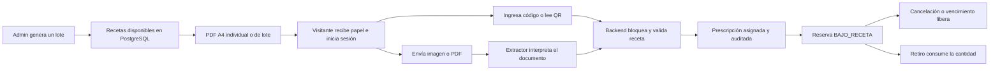

# Recetas electrónicas de demostración

Esta extensión del backend permite imprimir recetas ficticias, vincularlas a cuentas creadas durante la demo y reservar mediante el circuito habitual de MediLink. El documento lleva una leyenda visible de uso académico y datos de una institución y un profesional inventados.

## Arquitectura y persistencia

`recetademo` genera lotes, entrega PDFs y coordina la vinculación. `escaneo` valida y normaliza el archivo y usa la interfaz `PrescriptionImageExtractor`. Su implementación OpenAI devuelve una lectura estructurada. El backend compara los campos leídos con los datos persistidos. El extractor de las pruebas se simula con Mockito y el cliente HTTP se prueba contra un servidor local.

`V5__recetas_demo.sql` agrega la tabla `receta_demo`. Cada fila tiene un código único aleatorio de 128 bits, un identificador de lote, fechas, una presentación existente y una copia de sus datos impresos. La cantidad autorizada es una unidad. En estado `DISPONIBLE`, el titular, la prescripción y la fecha de asignación están vacíos. En `ASIGNADA`, los tres campos están completos. La migración agrega las acciones `GENERAR_RECETA_DEMO` y `VINCULAR_RECETA_DEMO` a la auditoría. Los eventos omiten el código de reclamo y el contenido escaneado.

`V6__receta_demo_verificacion.sql` agrega `receta_demo.codigo_verificacion` con restricciones de formato y unicidad en PostgreSQL. Cada receta nueva recibe un segundo código independiente, por ejemplo `MED-8K29-P7Q4-ABCD`. El servidor lo genera con `SecureRandom` y 12 símbolos de un alfabeto de 32 caracteres, con 60 bits de entropía. Si alguno de los dos códigos colisiona, vuelve a intentar la inserción. El código secundario se imprime en el PDF administrativo y queda fuera de los JSON de usuario y de la auditoría.

Las filas anteriores a V6 conservan `NULL` en la columna nueva. Las prescripciones ya vinculadas conservan su titular y sus datos. Los PDF anteriores pueden escanearse aplicando las comparaciones originales. Si coinciden, el backend devuelve `RECETA_VERIFICADA_LEGADA`. Una reimpresión indica que se trata de una emisión anterior. Las recetas nuevas requieren que el código secundario se lea y coincida exactamente en el flujo de escaneo.

La vinculación obtiene el usuario desde la cuenta autenticada y bloquea la fila de la receta. La creación de `Prescripcion` e `ItemPrescripcion`, la asignación y la auditoría se confirman juntas. El código impreso se convierte en `codigoExterno`. El circuito de reservas registra los compromisos y consumos en `ItemPrescripcion`. Se conserva una sola fuente para esas cantidades.

Antes de emitir el lote se normaliza el espaciado del texto del catálogo y se comprueba que la tipografía del PDF pueda imprimirlo fielmente. Una presentación con caracteres que la fuente no admite devuelve `400 VALIDATION_ERROR` antes de generar códigos.



## Contrato REST

Las rutas protegidas reciben `Authorization: Bearer <accessToken>`. Los códigos deben viajar en el cuerpo de la vinculación. Los resultados que contienen códigos o PDFs se entregan con `Cache-Control: no-store`.

| Método y ruta | Rol | Entrada y respuesta |
| --- | --- | --- |
| `POST /api/admin/recetas-demo/lotes` | ADMINISTRADOR | JSON con `presentacionId`, `cantidad` entre 1 y 100, y `fechaVencimiento` ISO. Devuelve `201`, UUID `lote` y `recetas[]` con ID, código, estado y datos impresos. La emisión toma la fecha argentina del servidor. |
| `GET /api/admin/recetas-demo/{id}/pdf` | ADMINISTRADOR | `200 application/pdf`, una página A4. |
| `GET /api/admin/recetas-demo/{id}/pdf-alterado` | ADMINISTRADOR | `200 application/pdf` para una receta nueva, con el modo de prueba habilitado. Devuelve una copia marcada como simulación. |
| `GET /api/admin/recetas-demo/lotes/{lote}/pdf` | ADMINISTRADOR | `200 application/pdf`, una página A4 por receta del lote. |
| `POST /api/me/recetas-demo/vinculacion` | USUARIO | JSON `{"codigoReceta":"MLD-..."}`. Devuelve `200` con `nueva` y `prescripcion` del tipo existente `PrescripcionDTO`. |
| `POST /api/me/recetas-demo/escaneo` | USUARIO | `multipart/form-data` con la parte `archivo`. Devuelve `nueva`, `prescripcion` y `codigo` con `RECETA_VERIFICADA` o `RECETA_VERIFICADA_LEGADA`. |
| `GET /api/me/prescripciones?page=0&size=20` | USUARIO | `200` con prescripciones propias en `PageDTO`. Orden por emisión e ID descendentes. |
| `GET /api/me/prescripciones/{id}` | USUARIO | `200 PrescripcionDTO` para la prescripción propia. Una ajena o inexistente devuelve el mismo `404`. |

El primer reclamo válido devuelve `nueva: true`. Un reintento del titular devuelve la misma prescripción con `nueva: false`. Otro usuario recibe el mismo `404 RESOURCE_NOT_FOUND` que un código inexistente. Una receta disponible fuera de vigencia devuelve `409 RECETA_DEMO_NO_VIGENTE`. Si llegan dos reclamos de usuarios distintos, la transacción que obtiene primero el bloqueo se queda con la receta y la otra recibe `404`. La autorización de reserva vuelve a comprobar fechas, anulación, titularidad, presentación y saldo.

| Error de escaneo | HTTP | Acción de la interfaz |
| --- | --- | --- |
| `VALIDATION_ERROR` | 400 | Pedir un JPG, PNG, WebP o PDF válido de una página. |
| `ARCHIVO_DEMASIADO_GRANDE` | 413 | Pedir una imagen más liviana o de menor resolución. |
| `LECTURA_INCONCLUSA` | 422 | Pedir otra foto u ofrecer ingreso manual. |
| `RECETA_DEMO_DATOS_NO_COINCIDEN` | 409 | Rechazar el reclamo por escaneo y mostrar el mensaje de la API. |
| `RECETA_DEMO_CODIGO_VERIFICACION_INCORRECTO` | 409 | Rechazar si el código secundario legible difiere del persistido. |
| `ESCANEO_LIMITE` | 429 | Mostrar un reintento posterior. |
| `ESCANEO_PROVEEDOR_ERROR` | 502 | Ofrecer reintento o ingreso manual. |
| `ESCANEO_NO_CONFIGURADO` | 503 | Ofrecer ingreso manual. |
| `ESCANEO_TIMEOUT` | 504 | Ofrecer reintento o ingreso manual. |

## Comparación documental

OpenAI transcribe los campos visibles. Spring Boot comprueba que la lectura esté completa y, dentro de la transacción, busca por el código principal exacto y comprueba primero la titularidad. Compara ambos códigos con sus mayúsculas y guiones, las fechas ISO y la cantidad autorizada con coincidencia exacta. Para medicamento, presentación y textos de plantilla aplica normalización Unicode, de espacios y de mayúsculas. Para la concentración conserva el valor, la unidad y su capitalización. Solo normaliza espacios y las dos representaciones Unicode del símbolo micro. También exige la leyenda de receta ficticia, título, profesional, institución, paciente pendiente e indicaciones de la plantilla. Una receta disponible debe estar vigente para generar la prescripción. Una solicitud del titular que pasa las comprobaciones devuelve su prescripción existente.

Si el código secundario falta o resulta ilegible en una receta nueva, la API devuelve `422 LECTURA_INCONCLUSA`. Una lectura completa con un secundario distinto devuelve `409 RECETA_DEMO_CODIGO_VERIFICACION_INCORRECTO`. Cambiar la concentración, la cantidad u otro campo del documento devuelve `409 RECETA_DEMO_DATOS_NO_COINCIDEN`. La validación se completa antes de guardar la prescripción, el titular o el evento de vinculación.

## OpenAI y archivos

Con el escaneo habilitado, el backend envía una imagen JPEG normalizada a Responses API mediante `input_image` con detalle `high` y solicita Structured Outputs en `text.format`. El esquema estricto exige ambos campos de código y admite `null` cuando un campo no se pudo leer o el código secundario está ausente en una emisión anterior. La respuesta incluye fechas, leyenda, profesional, institución, paciente, indicaciones, ítems, estado y campos faltantes. El extractor ignora las instrucciones del documento y transcribe los códigos sin completarlos ni inferirlos del QR. El sistema usa `store: false` y espera al proveedor antes de abrir la transacción de vinculación. [OpenAI Docs sobre imágenes](https://developers.openai.com/api/docs/guides/images-vision) · [OpenAI Docs sobre Structured Outputs](https://developers.openai.com/api/docs/guides/structured-outputs?api-mode=responses)

| Variable del backend | Configuración |
| --- | --- |
| `MEDLINK_RECETAS_ESCANEO_ENABLED` | `false` por defecto. Establecer `true` para habilitar el proveedor. |
| `MEDLINK_RECETAS_DEMO_PDF_ALTERADO_ENABLED` | `false` por defecto. Establecer `true` en el entorno de prueba para habilitar la copia administrativa de simulación. |
| `OPENAI_API_KEY` | Clave privada en el entorno de Spring Boot. |
| `OPENAI_MODEL` | Modelo habilitado en tu cuenta con entrada de imágenes y salida estructurada. |
| `MEDLINK_RECETAS_ESCANEO_MAX_BYTES` | 6.291.456 bytes por defecto, hasta 8 MiB. El límite total multipart es 9 MiB. |
| `MEDLINK_RECETAS_ESCANEO_TIMEOUT_SECONDS` | 25 segundos por defecto. Admite valores entre 1 y 90. |

El servidor comprueba el contenido del archivo, admite hasta 4096 píxeles por lado y 12 millones de píxeles en total. Rasteriza PDF de una sola página a 144 dpi y limita la imagen enviada a 2400 píxeles por lado. La conversión descarta los metadatos de las imágenes. Spring elimina los temporales multipart al terminar la solicitud. Los límites por instancia son seis intentos por cuenta y 60 en total por minuto, con tres escaneos simultáneos. El frontend debe enviar exclusivamente recetas ficticias y mostrar esa condición antes de subir un documento. Una foto girada, borrosa o cortada puede requerir otra toma. La lectura exacta de una foto depende del modelo y de la calidad de captura.

Para configurar la demo en IntelliJ, agregá las variables a la configuración de Spring Boot. Compose lee las mismas variables desde el entorno o `.env`. El camino por código, la impresión y la reserva funcionan con el escaneo apagado. La suite Maven usa un extractor simulado y un servidor HTTP de pruebas en localhost.

El escaneo real factura tokens de entrada de imagen y texto, y tokens de salida, a las tarifas del modelo configurado. Estimá la imagen con el tamaño tras la normalización y el detalle `high`, y sumá el texto de entrada y la salida del modelo. El costo puede existir aunque el backend rechace el documento después de leerlo. El ingreso manual queda fuera de ese consumo. Los límites locales son por instancia y se suman a las cuotas de la cuenta de OpenAI. [Calculadora de costo de imagen de OpenAI](https://developers.openai.com/api/docs/guides/image-cost-calculator) · [Tarifas de la API](https://developers.openai.com/api/docs/pricing)

PDFBox y ZXing generan las páginas y el QR. El QR lleva únicamente el código de reclamo. TwelveMonkeys ImageIO permite leer WebP. [PDFBox](https://pdfbox.apache.org/) · [ZXing](https://github.com/zxing/zxing) · [TwelveMonkeys](https://github.com/haraldk/TwelveMonkeys)

## Demostración con un PDF original y uno alterado

Usá un entorno de desarrollo con Flyway V6 aplicado y habilitá `MEDLINK_RECETAS_DEMO_PDF_ALTERADO_ENABLED`. Para ejecutar el escaneo real, configurá también `MEDLINK_RECETAS_ESCANEO_ENABLED=true`, `OPENAI_API_KEY` y `OPENAI_MODEL` en el backend. Los dos PDF se pueden generar con el escaneo apagado.

Con el JWT de administrador en `$adminToken`, generá una receta para una presentación activa bajo receta. Verificá en tu catálogo el ID de la presentación que quieras usar. El ejemplo usa el ID de levotiroxina de los datos de prueba.

```powershell
$api = 'http://localhost:8081'
$headers = @{ Authorization = "Bearer $adminToken" }
$body = @{
    presentacionId = 9
    cantidad = 1
    fechaVencimiento = (Get-Date).AddDays(7).ToString('yyyy-MM-dd')
} | ConvertTo-Json
$lote = Invoke-RestMethod "$api/api/admin/recetas-demo/lotes" -Method Post -Headers $headers `
    -ContentType 'application/json' -Body $body
$id = $lote.recetas[0].id
Invoke-WebRequest "$api/api/admin/recetas-demo/$id/pdf" -Headers $headers -OutFile 'A-original.pdf'
Invoke-WebRequest "$api/api/admin/recetas-demo/$id/pdf-alterado" -Headers $headers -OutFile 'B-alterada.pdf'
```

La sección **VERIFICACIÓN DE DOCUMENTO MEDILINK** muestra ambos códigos, el QR de reclamo y la instrucción para fotografiar la página completa. El PDF B conserva los dos códigos y el QR, cambia la concentración a `200 mcg` (`100 mcg` si la original ya era `200 mcg`) e imprime **SIMULACIÓN — DOCUMENTO ALTERADO**. La descarga toma los datos de la misma fila y no modifica su concentración ni emite una receta nueva.

1. Iniciá sesión como `USUARIO` y abrí **Mis recetas** en `/mis-recetas`.
2. Subí B primero y presioná **Analizar y verificar receta con IA**. La respuesta esperada es `409 RECETA_DEMO_DATOS_NO_COINCIDEN`. La receta sigue sin asignarse.
3. Subí A. La respuesta esperada es `200 RECETA_VERIFICADA`, con `nueva: true`, y la prescripción aparece en la lista.
4. Repetí A con la misma cuenta para verificar `nueva: false`. Con otra cuenta, el mismo documento devuelve `404 RESOURCE_NOT_FOUND`.
5. Para ensayar una foto, usá la página completa con ambos códigos visibles. Una captura recortada o ilegible puede devolver `422 LECTURA_INCONCLUSA`.

El ingreso manual de React comprueba el código principal, la vigencia y la titularidad. Para ensayarlo por separado, generá otra receta disponible. En Capacitor, la cámara o galería deberá entregar un archivo con un formato admitido para el mismo multipart. Validá los permisos, las URI de archivo y la conexión HTTPS del dispositivo. La lectura local del QR puede seguir enviando el código principal al flujo manual.

## Imprimir 30 recetas y ensayar la presentación

Usá una base de demostración con un administrador, un operador y stock suficiente para una presentación activa `BAJO_RECETA`. El entorno de mapas carga los datos de demo manualmente según su guía. Si elegís levotiroxina de los datos de prueba, confirmá el ID de la presentación en tu base. En el seed base es `9`. [Guía de mapas](DEMO_MAPAS_MVP.md)

Con el backend local en IntelliJ y un token de administrador disponible en `$adminToken`, ejecutá desde PowerShell.

```powershell
$api = 'http://localhost:8081'
$headers = @{ Authorization = "Bearer $adminToken" }
$body = @{
    presentacionId = 9
    cantidad = 30
    fechaVencimiento = (Get-Date).AddDays(7).ToString('yyyy-MM-dd')
} | ConvertTo-Json
$lote = Invoke-RestMethod "$api/api/admin/recetas-demo/lotes" -Method Post -Headers $headers `
    -ContentType 'application/json' -Body $body
Invoke-WebRequest "$api/api/admin/recetas-demo/lotes/$($lote.lote)/pdf" `
    -Headers $headers -OutFile "MediLink-lote-$($lote.lote).pdf"
```

1. Imprimí el PDF A4. El lote contiene una receta por página. Entregá una página a cada visitante.
2. Registrá un usuario mediante `POST /api/auth/register` e iniciá sesión mediante `POST /api/auth/login`. Guardá el `accessToken` para las solicitudes siguientes.
3. Vinculá un código con `POST /api/me/recetas-demo/vinculacion`, o adjuntá la foto en la parte `archivo` del endpoint de escaneo si configuraste OpenAI. Consultá `GET /api/me/prescripciones` para comprobar la titularidad. Si repetís el mismo código, verás `nueva: false`.
4. Reservá con `POST /api/reservas`, encabezado `Idempotency-Key` con un UUID nuevo y cuerpo `{"farmaciaId":1,"presentacionId":9,"cantidad":1,"codigoPrescripcion":"MLD-..."}`. Sustituí la farmacia y presentación por las de tu base. El código se toma de `prescripcion.codigoExterno`.
5. Probá otra reserva con el mismo código y una nueva clave de idempotencia mientras la primera está activa. La unidad ya está comprometida. Si cancelás la primera, la autorización vuelve a estar disponible.
6. Creá otra reserva y, con una cuenta operadora de esa farmacia, enviá `POST /api/farmacias/{farmaciaId}/reservas/{codigoVisible}/retiro`. Verificá en `GET /api/me/prescripciones/{id}` que el ítem pasó a `cantidadUtilizada: 1` y `cantidadDisponible: 0`. Un nuevo intento de reserva con ese código será rechazado.

React ofrece ingreso manual, captura o selección de archivos, estados de error y listado de prescripciones en **Mis recetas**. La generación del lote y las descargas de los PDF se realizan mediante la API administrativa. [Preguntas frecuentes](RECETAS_DEMO_FAQ.json)

## Límites de autenticidad

Los códigos y los datos visibles pueden copiarse junto con el documento. Un escaneo exitoso comprueba coherencia con los datos ficticios de MediLink. La originalidad física queda fuera del alcance de la prueba. Quien consiga una copia completa antes del primer reclamo puede intentar vincularla a su cuenta. El módulo está limitado a una demostración académica y el documento carece de validez médica.

## Base y verificaciones anteriores a V6

La rama local `feature/recetas-demo-ia` se adelantó desde `a281223` hasta `3ded636041aaad3fed20f60eeeb6b198832ffa59`, base de `origin/fix/mapas-mvp-demo`. Esa rama contiene `origin/IntegracionMapas` (`ef33286`) y cinco commits sobre `origin/main`. Ambas versiones de mapas contienen la misma V4. El HEAD quedó en el commit base y los cambios de este módulo están en el árbol de trabajo local.

`origin/fix/cierre-mvp-v1.4.3` estaba en `4709e6b`. Al integrar ramas, revisar los hunks compartidos en `PrescripcionRepository`, `PrescripcionService`, `.env.example` y Compose. La rama de cierre incorpora el bloqueo del titular antes de anular. Esta extensión introduce el camino de creación tras vincular y usa el orden Cuenta → Usuario → Receta demo. La integración debe conservar ambos comportamientos. Cierre aporta cambios propios al gateway y a la carga manual de datos, que deben convivir con las variables de escaneo. En el SHA revisado, cierre carece de una V5 que compita con la nueva migración.

| Verificación | Resultado |
| --- | --- |
| `mvnw.cmd -B -ntp clean verify` en la copia de la base de mapas | 185 pruebas aprobadas, 0 fallos, 0 errores, 0 omisiones |
| `mvnw.cmd -B -ntp clean verify` con la extensión | 207 pruebas aprobadas en 39 suites, 0 fallos, 0 errores, 0 omisiones |
| `scripts/verificar_tests_postgres.py` | 76 pruebas PostgreSQL 16 reales, incluidas 13 de recetas demo |
| Migración V4 → V5 en una base con datos | Filas de Farmacia, coordenadas, Stock y Reservas idénticas antes y después |
| PDF | Lote de 30 páginas, formato A4 individual y QR decodificado con ZXing. Muestra renderizada y revisada visualmente |
| OpenAI | Contrato HTTP, errores, rechazo e inconclusa verificados con servidor local y extractor simulado. La lectura con un modelo real queda para una prueba de demo con credenciales |
| Compose y espacios Git | `docker compose --profile api config --quiet` y `git diff --check` aprobados |

Las pruebas usaron PostgreSQL 16.15 en contenedores nuevos y datos de prueba. Los scripts de reconstrucción de farmacias 03 y 04 quedaron fuera de la ejecución. En GitHub, la corrida de mapas en `3ded636` marcó como fallidos los jobs de React y PostgreSQL antes de iniciarlos. Las anotaciones de ambos jobs atribuyen el bloqueo a la facturación de la cuenta. [Ejecución de mapas](https://github.com/GGian102-1020/MediLink/actions/runs/42092469387)

## Verificación de V6

| Verificación en Windows | Resultado |
| --- | --- |
| `mvnw.cmd -B -ntp clean verify` | 221 pruebas aprobadas en 39 suites, sin fallos, errores ni omisiones. |
| `scripts/verificar_tests_postgres.py` | 90 pruebas con PostgreSQL 16 aislado, incluidas 27 de recetas demo. |
| Migración V4 → V5 → V6 | Conservó las filas de Farmacia, Stock, Reservas y Prescripciones, las coordenadas y dos recetas V5, una disponible y una asignada. |
| PDF y escaneo | QR legible en ambas variantes. Con la extracción simulada, el original se vinculó, la copia alterada se rechazó y el recorte produjo lectura inconclusa. |
| `npm run typecheck`, `npm test` y `npm run build` | 45 pruebas aprobadas. La verificación de tipos y el build finalizaron correctamente. |
| `docker compose --profile api config --quiet` y `git diff --check` | Aprobados. |

El proveedor se simuló en las pruebas automatizadas. Queda pendiente ensayar ambos PDF y una fotografía de celular con el modelo configurado para la demo.

## Inventario

- Código nuevo en `recetademo` y `escaneo`, controlador `PrescripcionPropiaController`, recurso del logo y migración V5.
- V6 amplía `RecetaDemo`, `RecetaDemoRepository`, `RecetaDemoService`, `RecetaDemoDocumento`, `RecetaDemoDtos`, `RecetaDemoPdf` y sus dos controladores. También amplía `PrescriptionImageExtractor`, `OpenAiPrescriptionImageExtractor` y `RecetaDemoEscaneoService`.
- Cambios de integración en `PrescripcionService`, `PrescripcionRepository`, `AuditoriaFiltro` y `GlobalExceptionHandler`.
- Dependencias y configuración en `backend/pom.xml`, `application.properties`, `.env.example` y `docker-compose.yml`.
- Pruebas nuevas `RecetaDemoPostgresTest`, `RecetaDemoPdfTest`, `ArchivoRecetaTest` y `OpenAiPrescriptionImageExtractorTest`. El verificador de PostgreSQL exige la suite nueva.
- Pantalla provisional `MyPrescriptions.tsx`, cliente `recetas.ts` y pruebas de interfaz `myPrescriptions.test.tsx`.
- Documentación de esta extensión, FAQ estática y propuesta separada para el MVP.
